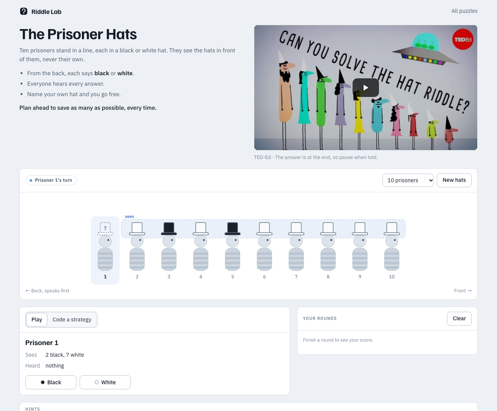
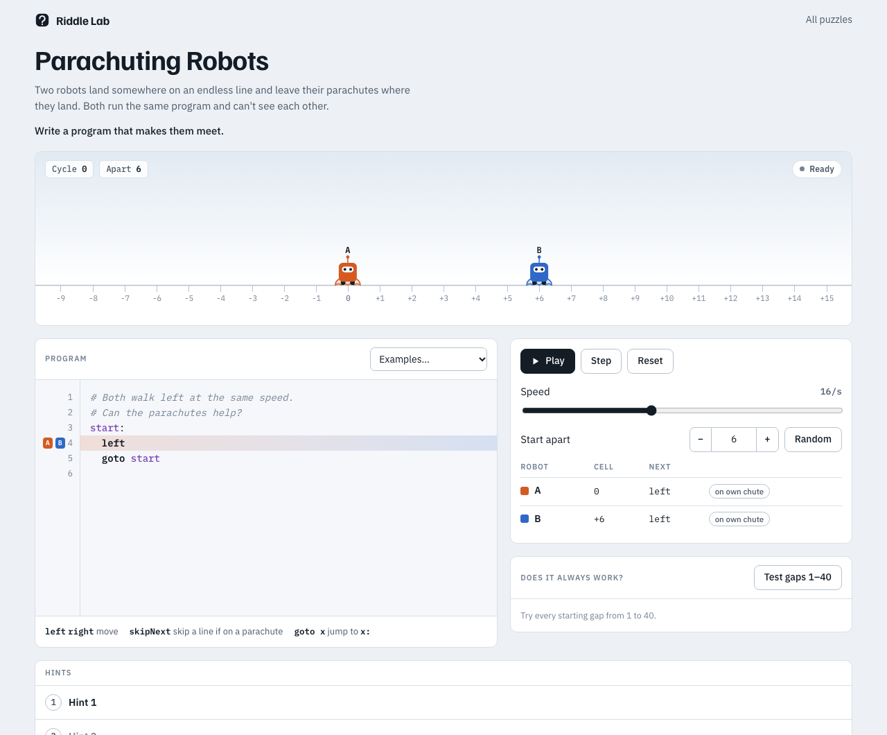
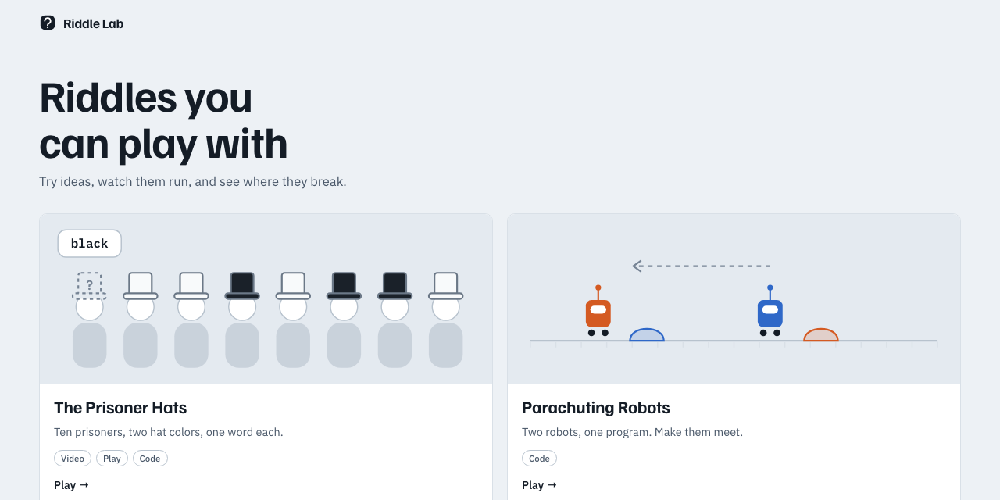

# Riddle Lab

**Brain teasers you can play with.** Each puzzle comes with a sandbox: try an
idea, watch it run, test it against every possible case, and see exactly where
it breaks.



## Puzzles

| | Puzzle | What you do |
|---|---|---|
| 🎩 | **The Prisoner Hats** | Ten prisoners, black and white hats, one word each. Play the line yourself, or write a strategy in **Python** or **Java** and test it on all 1,024 lineups. Includes the TED-Ed video. |
| 🪂 | **Parachuting Robots** | Two robots on an endless line run the same tiny program. Write the code that makes them meet, step through it, and test every starting gap. |

## Features

- **Sandbox first.** Every puzzle is something you poke at, not a page of text.
- **Does it always work?** One click runs your strategy on every case and charts the results.
- **Show me where it fails.** The checker finds the failing case, replays it, and stops on the exact mistake ("Prisoner 4 said white but wore black").
- **Hints in steps.** Three nudges before the solution, each opened only when you ask.
- **Real languages.** Hat strategies run as real Python (Pyodide, in the browser) or real Java (compiled by your JDK through the local server).

<p>
  
  
</p>

## Quick start

```sh
git clone https://github.com/WilliamTrump/riddle-lab.git
cd riddle-lab
python3 server.py
```

Open <http://127.0.0.1:8137>. No build step and no dependencies beyond Python 3.
Java strategies also need a JDK (11 or newer).

## How it works

Every puzzle implements the same small interface, so the runner, the checker
and the failing-case replay are shared:

```js
{
  cases(settings)          // every starting case to test
  start(strategy, case)    // starting state
  step(state, input?)      // advance one step (input = a move made by hand)
  result(state)            // null while running, then { ok, score, text }
  judge(rows)              // verdict for all cases, chart bars, the failing case
  mistake(state)           // optional: explain the step that went wrong
}
```

```
index.html                    puzzle list
server.py                     local server: static files + Java runner
shared/engine.js              puzzle interface, Runner, checkAll (browser + Node)
shared/shell.js               video, hint ladder, checker with failing-case replay
shared/shell.css              shared look, light and dark
puzzles/<name>/puzzle.js      a puzzle's rules, no page code
puzzles/<name>/index.html     intro, sandbox view, hints
puzzles/<name>/*.py           the same logic in Python, with a CLI and tests
puzzles/prisoner-hats/java/   harness that runs a Java Strategy on every lineup
tests/                        engine and puzzle tests
```

**Running player code.** Strategies run on whole batches of cases at once:
Python in a Web Worker (with a 10-second limit, so an endless loop can't freeze
the page) and Java through `server.py`, which compiles with `javac` and caches
builds. The answers come back as a table that the engine replays.

**Server safety.** `server.py` listens only on `127.0.0.1` and only accepts JSON
from its own pages, so other websites can't use it to run code. Java runs get a
time limit, an output cap, at most two at once, and everything they start is
killed afterwards. It's meant for your own machine, not the open internet:
Java code still runs with your permissions.

**Editor.** The strategy editor is [CodeMirror 5](https://codemirror.net/5/)
with Python and Java modes: auto-indent, keyword colors, bracket matching.

## Tests

```sh
node --test tests/*.test.js                          # engine + both puzzles
cd puzzles/prisoner-hats && python3 -m pytest        # Python versions
cd puzzles/parachuting-robots && python3 -m pytest
```

The JavaScript and Python versions of each puzzle are checked against the same
expected results.

## Command line

Both puzzles also work from the terminal:

```sh
python3 puzzles/parachuting-robots/parachuting_robots.py puzzles/parachuting-robots/examples/naive.robot
python3 puzzles/prisoner-hats/prisoner_hats.py --show 2
```

## Adding a puzzle

1. Put the rules in `puzzles/<name>/puzzle.js` using the interface above.
2. Copy an existing puzzle page and draw your stage from `runner.state`.
3. Mount the checker: `RiddleLab.mountChecker(el, { run, onBar, onReplay })`.
4. Add tests in `tests/` and a card on `index.html`.

## Credits

- Prisoner hat riddle video: [“Can you solve the prisoner hat riddle?”](https://www.youtube.com/watch?v=N5vJSNXPEwA) by Alex Gendler, TED-Ed, embedded from YouTube.
- Parachuting robots presentation inspired by [david-peter.de/parachuting-robots](https://david-peter.de/parachuting-robots/).
- Puzzle text, code and visuals are written for this project.
